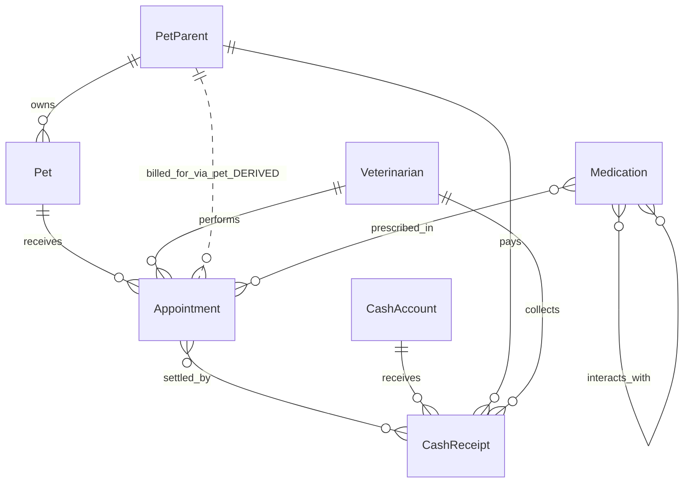

# UNNC Animal Hospital｜数据库架构与技术规范（修订工作版）

版本：2026-11-16 R4（对齐官方《Grading Rubrics》4×25 与《Computer Lab 2 - MS ACCESS》14 页指南）。保留原文件名方便链接，“最终版”指全组技术口径统一标准。

> **Rubric 4×25 快速对位表**：  
> - **Completeness (25)** → 第 2–3 节（REA 对齐 + 全 20 属性覆盖 + Lab 2 `CashAccount` 落表）+ 第 6–7 节（2 条/表样例口诀与衍生查询）；  
> - **Functionality & Reliability (25)** → 第 4 节全部 46 字段的数据类型、Format、Required/`Allow Zero Length=No` 与 Validation Rule（经三轮表录入压测）；  
> - **Primary Key & Foreign Key (25)** → 第 4 节 7 个单列 PK + 3 组联合 PK + 全部外键索引；  
> - **Relationships (25)** → 第 5 节 12 条 `1 → ∞` 正确方向参照完整性连线 + Guide 第 1 页文档化报表。

## 一、依据、假设与提交门槛

官方指南要求 REA 图、基于该图的 Access 关系数据库、每表两条自编记录、指定文件名与表定义/关系窗口文档化；现已并入正式《Grading Rubrics》（4×25=100 分，要求全字段约束且经受三轮数据录入测试、主外键准确、关系方向全部正确）及《Computer Lab 2》（证实每个 REA 实体均须建表，如 `Cash (R)`）。仍仅剩 D1（3 药 vs 严格 2 行）与 D3（`CollectedByVetID` 是否必填）待 11-19 前拍板。见 [原文](assignment2_source.md) 与 [05 约束边界](05_AI思考约束边界_课程对齐Prompt.md)。

本修订采用 **10 张表、46 个字段、12 条外键关系**：将现金账户 (`tblCashAccount`) 纳入实体；开发原型假设两名样例兽医也可代收款，在收款表记录必填外键 `CollectedByVetID`。**这是组长须在 `11-19` 建底库前确认的 D3 门槛假设**：若认为病例未要求收款经办人，建库前可改为允许空值 (`Required=No`) 或移除 `CollectedByVetID` 及第 12 条关系；若由非兽医收银员收款，应改建独立 `tblEmployee` 并同步全部图、字段、窗体、样例与 `T20` 测试。

其他假设：每只宠物一个当前登记主人；已发生就诊用 Appointment 表，不包含未来预约工作流；支持分次付款、合并付款、未分配收款，不支持跨主人代付。宠物已有历史就诊后不直接更换主人，否则历史账单归属会随之变化；如需转主人，另设计带有效期的归属历史。药品数量以整包装为单位；不是临床剂量。诊疗费用及历史处方价格不因目录价变化而更新。

**样例数量门槛**：指南写的是“Insert two records into each table”，不能断言是“至少”。下列开发样例药品表含 3 条，其余 9 表各 2 条，只用于原型测试，不标为可提交。组长须确认是否允许第 3 种药以形成两个不同无方向药对；未确认前不得宣称样例完全符合要求。若必须每表恰好两条，应与老师确认互动规则的记录粒度；仅当同一药对确有两条不同条件的规则时才新增 ConditionCode，且必须同步主键、查询和测试，不能为凑数临时加列。见 00 中的 D1。

## 二、REA 概念图与关系语义

下图是概念关系示意。正式图按 R/E/A 三列排版，Pet 单列为服务对象；颜色不是已确认的评分要求。以每端基数的文字含义为准。桥接表留在物理关系图，不在这张概念图中冒充新的经济事件。



R = Medication、CashAccount；E = Appointment、CashReceipt；A = PetParent、Veterinarian。`PetParent—Appointment` 经 Pet 派生，不额外重复存 ParentID；这一简化依赖上述历史归属不直接变更假设。Medication → Appointment 表示开药使用资源；CashReceipt → CashAccount 表示流入；Appointment ↔ CashReceipt 表示交换的对偶关系。

（Mermaid 中 `..` 虚线表示 PetParent—Appointment 为经 Pet 派生的关系，物理库不另存外键；正式图中也画虚线并标 “via Pet”。）

**画图符号（课件惯例，不是本作业评分细则）**：[Handout_cardinality.pdf](<D:/AIS/Week05_2026-11-02_to_08/originals/Handout_cardinality.pdf>) 第 1 页写明 “Cardinality (my preferred method for cardinality)” 为 `|`（一 / 必须）、`O`（可为零）、`<`（多），且线上配带实心三角的动词方向标签（如 `Belongs to ▶`、`Teaches ▶`）；Week 6 Slide 8 示例为 `Operation (O<) ─── (|) Doctor`。在 Lab 2 / Rubric 没有不同规定前，本组正式 REA 图**默认使用这套符号 + 动词箭头**，不改用 `(0,N)` 数字括号，避免组员各画一套。颜色、线型不是已知要求，统一即可。

读法：符号画在**靠近被计数的那一端**。例如“每次就诊恰好 1 位兽医、每位兽医 0..多次就诊”画成 `Veterinarian (|) ── Performs ▶ ── (O<) Appointment`：`|` 贴兽医框，`O<` 贴就诊框。

| 关系 | 动词方向标签 | 一条左侧记录可对应的右侧记录数 | 一条右侧记录可对应的左侧记录数 | 图上符号：左框端 ─── 右框端 |
|---|---|---|---|---|
| PetParent → Pet | `Owns ▶` | 0..多 | 恰好 1 | `\|` ─── `O<` |
| Pet → Appointment | `Attends ▶` | 0..多 | 恰好 1 | `\|` ─── `O<` |
| Veterinarian → Appointment | `Performs ▶` | 0..多 | 恰好 1 | `\|` ─── `O<` |
| PetParent → Appointment（派生，虚线） | `Billed for ▶ (via Pet)` | 0..多 | 恰好 1 | `\|` ┄┄ `O<`（虚线标 via Pet） |
| Medication → Appointment | `Prescribed in ▶` | 0..多 | 0..多 | `>O` ─── `O<` |
| Medication → Medication | `Interacts with ▶` | 0..多（排除自身） | 0..多（无方向药对） | 自环两端均为 `O<` |
| Appointment → CashReceipt | `Settled by ▶` / `Settles ◀` | 0..多 | 0..多 | `>O` ─── `O<` |
| CashAccount → CashReceipt | `Receives ▶` / `Flows into ◀` | 0..多 | 恰好 1 | `\|` ─── `O<` |
| PetParent → CashReceipt | `Pays ▶` | 0..多 | 恰好 1 | `\|` ─── `O<` |
| Veterinarian → CashReceipt | `Collects ▶ (Assumption)` | 0..多 | 恰好 1 | `\|` ─── `O<` |

> 自检：任挑一行，用“一条 X 对应几条 Y”读一遍；读出的话与符号对不上就是画反了。

**课件中另两条直接相关的说明**：Week 6 Slide 6 写明 “Documents (e.g. invoices) are not resources”，所以图中不画发票/收据单据；同页 Fun Park 参考图在 Cash 旁注了 `(cash#, bank, balance)`，本方案用 `tblCashAccount`（AccountID、AccountName、AccountType）对应现金资源，余额由收款汇总得出、不另存。

## 三、属性追溯

| 来源位置 | 原文属性 / 要求 | 本方案归属位置 | 归属理由（3NF 与 REA 解释） |
|---|---|---|---|
| Page 2 | `Parent name` | `tblPetParent.ParentName` | 主人基本信息，只存一次避免就诊重复填 |
| Page 2 | `Address` | `tblPetParent.Address` | 同上 |
| Page 2 | `Day phone` | `tblPetParent.DayPhone` | 用 Short Text 保存，防止前导零或区号分隔符丢失 |
| Page 2 | `Evening phone` | `tblPetParent.EveningPhone` | 同上 |
| Page 2 | `Pet name` | `tblPet.PetName` | 宠物静态主数据 |
| Page 2 | `Breed` | `tblPet.Breed` | 宠物静态主数据（可含物种说明如 `British Shorthair (Cat)`） |
| Page 2 | `Color` | `tblPet.Color` | 宠物静态主数据 |
| Page 2 | `Birth date` | `tblPet.BirthDate` | 日期型，验证 `<=Date()` |
| Page 2 | `Dr. Nottingham and three other veterinarians` | `tblVeterinarian` (`VetID, VetName, RoleTitle`) | 内部参与者表（样本录 2 位代表并在说明中注明 4 名合伙人背景） |
| Page 2 | `pet's weight` | `tblAppointment.WeightKg` | **随每次就诊动态变化**，必须放事件表而非 `tblPet` |
| Page 2 | `reason for the appointment` | `tblAppointment.VisitReason` | 当次就诊属性 |
| Page 2 | `doctor's diagnosis` | `tblAppointment.Diagnosis` | 当次就诊属性 |
| Page 3 prose | `charged for each appointment` | `tblAppointment.AppointmentFee` | 支撑“诊疗基础费 + 额外药费”拆分计费的诊疗收费字段（不是收款金额） |
| Page 3 #1 | `Number of pets owned by each parent` | **查询计算**：`qry_01_ParentPetCount` | 本方案采用派生查询：用 `LEFT JOIN + Count(PetID)` 算，避免更新异常 |
| Page 3 #2 | `Price of each specific medicine prescribed` | `UnitPriceCharged`，并展示 `qry_02_PrescriptionCharges.LineCharge` | 原文价格表述有重叠；同时展示实际单价、目录价、数量及行小计，避免把 price 擅自限定为小计 |
| Page 3 #3 | `Total charge for the appointment` | **查询计算**：`qry_03_AppointmentTotal.TotalAppointmentCharge` | `AppointmentFee + Nz(TotalMedCharge, 0)`，派生总额不存表 |
| Page 3 #4 | `Quantity of each specific medicine prescribed` | `tblPrescriptionLine.Quantity` | 处方桥接表属性，正整数验证见数据字典 |
| Page 3 #5 | `Price charged for each medication` | `tblPrescriptionLine.UnitPriceCharged` | 当次开药收费单价（与目录价解耦，保护历史账单） |
| Page 3 #6 | `Medication list price` | `tblMedication.ListPrice` | 药品当前标准目录价 |
| Page 3 #7 | `Medication name` | `tblMedication.MedicationName` | 药品显示名称；允许同名，使用 MedicationID 识别 |
| Page 3 #8 | `Adverse medication interactions with other medications` | `tblMedicationInteraction` | 自反多对多桥接表，表级验证 `MedicationAID < MedicationBID` |
| Page 3 #9 | `Total cash receipt amount` | `tblCashReceipt.ReceiptTotal` | 收款单实收总金额 |
| Page 3 #10 | `Appointment date` | `tblAppointment.AppointmentDate` | 就诊日期 |
| Page 3 #11 | `Cash receipt amount applied to a specific appointment` | `tblReceiptAllocation.AppliedAmount` | 收款与就诊的 M:N 核销分配金额 |
| Page 3 #12 | `Appointment length` | `tblAppointment.DurationMin` | 就诊时长（分钟），正整数验证见数据字典 |

补充说明：诊疗收费、处方实际单价不等于现金实收；实收由 CashReceipt 表示。派生金额用查询计算是本方案为减少更新异常所作的选择，不声称所有系统都禁止保存结账快照。

## 四、数据字典与输入规则（共 10 张表、46 个字段｜Functionality 25 + PK/FK 25 核心）

> **与《Computer Lab 2》风格对照说明（本组选用更稳妥的 SQL-Safe 规范）**：  
> Lab 2 示例中采用了带括号空格的表名（`Customer (EA)`、`Sale-Inventory`）、短文本前缀编码主键（如 `CUST-01` 配 `Left([Customer#],5)="CUST-"`）以及 `Number (Single) + Format Currency`。本组保持当前 **`tbl...` 无空格命名 + `AutoNumber/Long Integer` 主外键 + `Currency`（配 `Round(...,2)`）**，既完全满足 4×25 Rubric 对 PK 唯一性、类型约束及 `1→∞` 关系的全部指标，又消除 SQL 方括号及 `Single` 浮点精度隐患（已在真实 Access 16.0 通过 65 项检查）；同时 Lab 2 第 9 页 Hint a 强调的“按单价 (`each`) 而非汇总记录成交价”已由 `tblPrescriptionLine.UnitPriceCharged` 严格落实。

所有短文本必填字段：`Required=Yes` 且 `Allow Zero Length=No`；说明和电话仍需合理录入，不以名称唯一来识别人。可选 EveningPhone 允许 Null；不用空字符串代替缺失值。姓名允许重名，下拉同时显示 ID/电话；药名允许重名，下拉显示 ID/目录价。

金额使用 Currency，显示 2 位小数；存储类型有更高精度，显示格式不等于输入约束。对每个金额字段设置表级或字段级“两位小数”规则（例 `[ReceiptTotal]=Round([ReceiptTotal],2)`），与原有正值/非负规则同时生效。`Currency` 格式跟随系统区域设置，最终统一币种标签；`CCur` 转类型不保证每台电脑显示人民币符号。

数量、分钟采用 Number / Double 配合显式 `=Int(...)` 规则，避免整数存储类型先把小数舍入后再验证。数量 1..100000、分钟 1..1440 是原型边界假设，不是指南指定值；格式最多显示整数，但必须实测 1.5 被拒绝。出生日期不晚于当天，收款日期不晚于当天。跨表的“就诊不早于出生”由测试/异常核查负责，不伪称普通外键能验证。

### 表 1：`tblPetParent`（宠物主人表｜External Agent）

| Field Name | Data Type | Size / Subtype | Key / Index | Required | Format | Validation Rule | Validation Text | Description（粘贴到 Access） |
|---|---|---|---|---|---|---|---|---|
| `ParentID` | AutoNumber | Long Integer | **PK** | Yes | - | - | - | Unique identifier for each pet parent |
| `ParentName` | Short Text | 100 | Indexed (Duplicates OK) | Yes | - | - | - | Full name of the pet parent/customer |
| `Address` | Short Text | 255 | No | Yes | - | - | - | Home mailing address of the parent |
| `DayPhone` | Short Text | 20 | No | Yes | - | - | - | Daytime phone number (text preserves leading zeros) |
| `EveningPhone` | Short Text | 20 | No | No | - | - | - | Evening phone number (optional) |

### 表 2：`tblPet`（宠物档案表｜Supporting Entity）

| Field Name | Data Type | Size / Subtype | Key / Index | Required | Format | Validation Rule | Validation Text | Description（粘贴到 Access） |
|---|---|---|---|---|---|---|---|---|
| `PetID` | AutoNumber | Long Integer | **PK** | Yes | - | - | - | Unique identifier for each pet |
| `ParentID` | Number | Long Integer | **FK** (Indexed Dup OK) | Yes | - | - | - | Foreign key referencing tblPetParent.ParentID |
| `PetName` | Short Text | 80 | No | Yes | - | - | - | Pet's name |
| `Breed` | Short Text | 100 | No | Yes | - | - | - | Pet species and breed (e.g., British Shorthair Cat) |
| `Color` | Short Text | 50 | No | Yes | - | - | - | Coat/feather color of the pet |
| `BirthDate` | Date/Time | Short Date | No | Yes | Short Date | `<=Date()` | `Birth date cannot be in the future.` | Pet's date of birth (must be on or before today) |

### 表 3：`tblVeterinarian`（兽医表｜Internal Agent）

| Field Name | Data Type | Size / Subtype | Key / Index | Required | Format | Validation Rule | Validation Text | Description（粘贴到 Access） |
|---|---|---|---|---|---|---|---|---|
| `VetID` | AutoNumber | Long Integer | **PK** | Yes | - | - | - | Unique identifier for each veterinarian |
| `VetName` | Short Text | 100 | Indexed (Duplicates OK) | Yes | - | - | - | Full name/title of the veterinarian |
| `RoleTitle` | Short Text | 100 | No | Yes | - | - | - | Role in hospital (e.g., Co-Owner / Lead Veterinarian) |

### 表 4：`tblAppointment`（诊疗就诊事件表｜Give Event）

| Field Name | Data Type | Size / Subtype | Key / Index | Required | Format | Validation Rule | Validation Text | Description（粘贴到 Access） |
|---|---|---|---|---|---|---|---|---|
| `AppointmentID` | AutoNumber | Long Integer | **PK** | Yes | - | - | - | Unique identifier for each single-pet appointment |
| `PetID` | Number | Long Integer | **FK** (Indexed Dup OK) | Yes | - | - | - | Foreign key referencing tblPet.PetID (one pet per visit) |
| `VetID` | Number | Long Integer | **FK** (Indexed Dup OK) | Yes | - | - | - | Foreign key referencing tblVeterinarian.VetID |
| `AppointmentDate` | Date/Time | Short Date | No | Yes | Short Date | - | - | Date of the veterinary appointment |
| `DurationMin` | Number | Double | No | Yes | General Number | `>0 And <=1440 And =Int([DurationMin])` | `Enter whole minutes from 1 to 1440.` | Length of appointment in minutes |
| `WeightKg` | Number | Double | No | Yes | Fixed (Decimal: 2) | `>0` | `Pet weight must be greater than 0 kg.` | Pet weight recorded during this specific appointment (kg) |
| `VisitReason` | Short Text | 255 | No | Yes | - | - | - | Reason for the appointment reported by the parent |
| `Diagnosis` | Short Text | 255 | No | Yes | - | - | - | Veterinarian's clinical diagnosis |
| `AppointmentFee` | Currency | Currency | No | Yes | Currency (Decimal: 2) | `(>=0) And [AppointmentFee]=Round([AppointmentFee],2)` | `Enter a non-negative amount with at most two decimal places.` | Base service fee charged for the appointment (excl. medicine) |

### 表 5：`tblMedication`（药品目录表｜Resource）

| Field Name | Data Type | Size / Subtype | Key / Index | Required | Format | Validation Rule | Validation Text | Description（粘贴到 Access） |
|---|---|---|---|---|---|---|---|---|
| `MedicationID` | AutoNumber | Long Integer | **PK** | Yes | - | - | - | Unique identifier for each medication |
| `MedicationName` | Short Text | 100 | Indexed (Duplicates OK) | Yes | - | - | - | Display name of medication; ID identifies the catalog item |
| `ListPrice` | Currency | Currency | No | Yes | Currency (Decimal: 2) | `(>=0) And [ListPrice]=Round([ListPrice],2)` | `Enter a non-negative amount with at most two decimal places.` | Current standard catalog price per unit |

### 表 6：`tblPrescriptionLine`（处方明细桥接表｜Appointment–Medication M:N）

| Field Name | Data Type | Size / Subtype | Key / Index | Required | Format | Validation Rule | Validation Text | Description（粘贴到 Access） |
|---|---|---|---|---|---|---|---|---|
| `AppointmentID` | Number | Long Integer | **Composite PK (1/2) & FK** | Yes | - | - | - | Foreign key referencing tblAppointment.AppointmentID |
| `MedicationID` | Number | Long Integer | **Composite PK (2/2) & FK** | Yes | - | - | - | Foreign key referencing tblMedication.MedicationID |
| `Quantity` | Number | Double | No | Yes | General Number | `>0 And <=100000 And =Int([Quantity])` | `Enter whole units from 1 to 100000.` | Number of units prescribed for this medication |
| `UnitPriceCharged` | Currency | Currency | No | Yes | Currency (Decimal: 2) | `(>=0) And [UnitPriceCharged]=Round([UnitPriceCharged],2)` | `Enter a non-negative amount with at most two decimal places.` | Actual unit price charged at the time of prescription |

### 表 7：`tblCashReceipt`（现金收款事件表｜Take Event）

| Field Name | Data Type | Size / Subtype | Key / Index | Required | Format | Validation Rule | Validation Text | Description（粘贴到 Access） |
|---|---|---|---|---|---|---|---|---|
| `ReceiptID` | AutoNumber | Long Integer | **PK** | Yes | - | - | - | Unique identifier for each cash receipt |
| `ParentID` | Number | Long Integer | **FK** (Indexed Dup OK) | Yes | - | - | - | Foreign key referencing paying tblPetParent.ParentID |
| `AccountID` | Number | Long Integer | **FK** (Indexed Dup OK) | Yes | - | - | - | Cash account receiving this payment |
| `CollectedByVetID` | Number | Long Integer | **FK** (Indexed Dup OK) | Yes | - | - | - | Vet who collected payment under prototype staffing assumption |
| `ReceiptDate` | Date/Time | Short Date | No | Yes | Short Date | `<=Date()` | `Receipt date cannot be in the future.` | Date payment was received |
| `ReceiptTotal` | Currency | Currency | No | Yes | Currency (Decimal: 2) | `(>0) And [ReceiptTotal]=Round([ReceiptTotal],2)` | `Enter a positive amount with at most two decimal places.` | Total cash amount received from parent in this payment |

### 表 8：`tblReceiptAllocation`（收款核销分配表｜CashReceipt–Appointment M:N）

| Field Name | Data Type | Size / Subtype | Key / Index | Required | Format | Validation Rule | Validation Text | Description（粘贴到 Access） |
|---|---|---|---|---|---|---|---|---|
| `ReceiptID` | Number | Long Integer | **Composite PK (1/2) & FK** | Yes | - | - | - | Foreign key referencing tblCashReceipt.ReceiptID |
| `AppointmentID` | Number | Long Integer | **Composite PK (2/2) & FK** | Yes | - | - | - | Foreign key referencing tblAppointment.AppointmentID |
| `AppliedAmount` | Currency | Currency | No | Yes | Currency (Decimal: 2) | `(>0) And [AppliedAmount]=Round([AppliedAmount],2)` | `Enter a positive amount with at most two decimal places.` | Portion of receipt amount applied to settle this appointment |

### 表 9：`tblMedicationInteraction`（药物不良反应对照表｜Medication 自反 M:N）

| Field Name | Data Type | Size / Subtype | Key / Index | Required | Format | Validation Rule | Validation Text | Description（粘贴到 Access） |
|---|---|---|---|---|---|---|---|---|
| `MedicationAID` | Number | Long Integer | **Composite PK (1/2) & FK** | Yes | - | - | - | Smaller MedicationID in the interacting pair (FK -> tblMedication) |
| `MedicationBID` | Number | Long Integer | **Composite PK (2/2) & FK** | Yes | - | - | - | Larger MedicationID in the interacting pair (FK -> tblMedication) |
| `SeverityLevel` | Short Text | 20 | No | Yes | - | `"High" Or "Moderate" Or "Low"` | `Severity must be High, Moderate, or Low.` | Clinical severity category of the adverse interaction |
| `InteractionDescription` | Short Text | 255 | No | Yes | - | - | - | Description of adverse interaction between Medication A and B |

> [!CAUTION]
> **表 9 必填的表级验证规则（Table Validation Rule）**：  
> 在 `tblMedicationInteraction` 设计视图按 **`Alt + Enter`** 打开右方 **表属性表（Property Sheet）**：  
> - **Validation Rule**：`[MedicationAID]<[MedicationBID]`  
> - **Validation Text**：`MedicationAID must be strictly less than MedicationBID to prevent self-links and duplicate reverse pairs.`  
> **千万不要**把这句话写进单个字段的 Validation Rule，否则 Access 会报语法错误拒绝保存！

### 表 10：`tblCashAccount`（现金账户资源）

| Field Name | Data Type | Size / Subtype | Key / Index | Required | Format | Validation Rule | Validation Text | Description |
|---|---|---|---|---|---|---|---|---|
| `AccountID` | AutoNumber | Long Integer | **PK** | Yes | - | - | - | Unique cash account identifier |
| `AccountName` | Short Text | 60 | Indexed (Duplicates OK) | Yes | - | - | - | Cash register or bank account name |
| `AccountType` | Short Text | 30 | No | Yes | - | `"Cash" Or "Bank"` | `Choose Cash or Bank.` | Type of cash resource |

## 五、物理关系与建表顺序

建表后按下表建立 **12 条关系**，全部开启 Enforce Referential Integrity，全部关闭 Cascade Delete；AutoNumber 键不手工修改，Cascade Update 不作为依赖。重复使用 Medication/Veterinarian 表的显示别名只是关系窗口视图，不另建实体表。

| 主表.主键 | 子表.外键 |
|---|---|
| `tblPetParent.ParentID` | `tblPet.ParentID` |
| `tblPetParent.ParentID` | `tblCashReceipt.ParentID` |
| `tblPet.PetID` | `tblAppointment.PetID` |
| `tblVeterinarian.VetID` | `tblAppointment.VetID` |
| `tblAppointment.AppointmentID` | `tblPrescriptionLine.AppointmentID` |
| `tblMedication.MedicationID` | `tblPrescriptionLine.MedicationID` |
| `tblCashReceipt.ReceiptID` | `tblReceiptAllocation.ReceiptID` |
| `tblAppointment.AppointmentID` | `tblReceiptAllocation.AppointmentID` |
| `tblMedication.MedicationID` | `tblMedicationInteraction.MedicationAID` |
| `tblMedication.MedicationID` | `tblMedicationInteraction.MedicationBID` |
| `tblCashAccount.AccountID` | `tblCashReceipt.AccountID` |
| `tblVeterinarian.VetID` | `tblCashReceipt.CollectedByVetID` |

录入顺序：PetParent、Veterinarian、Medication、CashAccount → Pet → Appointment、MedicationInteraction、CashReceipt → PrescriptionLine、ReceiptAllocation。

PrescriptionLine 联合主键 `(AppointmentID, MedicationID)`；ReceiptAllocation 联合主键 `(ReceiptID, AppointmentID)`；MedicationInteraction 联合主键 `(MedicationAID, MedicationBID)`。其他表用 AutoNumber 主键。三张桥接表均有自己的业务粒度，禁止只给其中一列设主键。

### 5.1 课堂文本 Schema 写法（用于设计说明和规范化解释）

按 [Handout_normalization.pdf](<D:/AIS/Week06_2026-11-09_to_15/originals/Handout_normalization.pdf>) 第 1–2 页记法：括号外是表名，**主键加下划线**，*外键用斜体*；既是主键又是外键的字段两者都标。Word / Access 标签里用真实下划线和斜体；纯文本环境可用 `_PK_`、`*FK*` 代替。

- tblPetParent (<u>ParentID</u>, ParentName, Address, DayPhone, EveningPhone)
- tblPet (<u>PetID</u>, *ParentID*, PetName, Breed, Color, BirthDate)
- tblVeterinarian (<u>VetID</u>, VetName, RoleTitle)
- tblAppointment (<u>AppointmentID</u>, *PetID*, *VetID*, AppointmentDate, DurationMin, WeightKg, VisitReason, Diagnosis, AppointmentFee)
- tblMedication (<u>MedicationID</u>, MedicationName, ListPrice)
- tblPrescriptionLine (<u>*AppointmentID*</u>, <u>*MedicationID*</u>, Quantity, UnitPriceCharged)
- tblCashAccount (<u>AccountID</u>, AccountName, AccountType)
- tblCashReceipt (<u>ReceiptID</u>, *ParentID*, *AccountID*, *CollectedByVetID*, ReceiptDate, ReceiptTotal)
- tblReceiptAllocation (<u>*ReceiptID*</u>, <u>*AppointmentID*</u>, AppliedAmount)
- tblMedicationInteraction (<u>*MedicationAID*</u>, <u>*MedicationBID*</u>, SeverityLevel, InteractionDescription)

规范化解释时，用同一讲义的插入 / 更新 / 删除异常举例（例如：若把 WeightKg 放进 tblPet，就无法保留每次就诊的历史体重，属于更新异常），不要只写“拆成了 10 张表所以满足 3NF”。

## 六、开发样例与手算期望

以下数字 ID 是可复现原型的标签。手工录入时若 AutoNumber 跳号，记录实际 ID，并在所有子表使用对应实际值；查询不依赖编号连续。不删库重建只为追求 1、2、3。

1. **`tblPetParent`（2 条）**
   - `ParentID=1`: `Emily Chen` | `199 Taikang East Road, Ningbo` | `0574-88180001` | `13805740001`
   - `ParentID=2`: `David Wang` | `88 Qianhu North Road, Ningbo` | `0574-88180002` | `13905740002`
2. **`tblPet`（2 条）**
   - `PetID=1`: `ParentID=1` | `Mochi` | `British Shorthair (Cat)` | `Cream` | `2023-04-15`
   - `PetID=2`: `ParentID=1` | `Boba` | `Ragdoll (Cat)` | `Seal Bicolor` | `2024-06-20`
3. **`tblVeterinarian`（2 条）**
   - `VetID=1`: `Dr. Nottingham` | `Co-Owner / Lead Veterinarian`
   - `VetID=2`: `Dr. Lin` | `Co-Owner / Veterinarian`
4. **`tblMedication`（开发原型 3 条；提交是否允许三条尚未确认）**
   - `MedicationID=1`: `AmoxiVet Oral Suspension` | `35.00`
   - `MedicationID=2`: `FeliRelief Anti-Inflammatory` | `25.00`
   - `MedicationID=3`: `GastroCalm Drops` | `40.00`
5. **`tblMedicationInteraction`（2 条）**
   - `MedicationAID=1`, `MedicationBID=2`: `Moderate` | `Concurrent administration may increase gastrointestinal irritation (fictional sample rule).`
   - `MedicationAID=2`, `MedicationBID=3`: `High` | `Avoid co-administration within 4 hours due to reduced absorption (fictional sample rule).`
6. **`tblAppointment`（2 条）**
   - `AppointmentID=1`: `PetID=1`, `VetID=1`, `2026-11-10`, `30`, `4.20`, `Skin rash and mild fever`, `Mild bacterial dermatitis`, `120.00`
   - `AppointmentID=2`: `PetID=2`, `VetID=2`, `2026-11-12`, `20`, `3.80`, `Annual wellness checkup`, `Healthy; routine exam passed`, `90.00`
7. **`tblPrescriptionLine`（2 条）**
   - `AppointmentID=1`, `MedicationID=1`: `Quantity=2`, `UnitPriceCharged=30.00` *(故意低于目录价 35.00，展示实际收费单价与目录价分离；这是收费，不是现金实收)*
   - `AppointmentID=1`, `MedicationID=2`: `Quantity=1`, `UnitPriceCharged=25.00` *(等于目录价 25.00)*
   - *(注：`AppointmentID=2` 不开药，验证无处方就诊的计算)*
8. **`tblCashReceipt`（2 条）**
   - `ReceiptID=1`: `AccountID=1`, `CollectedByVetID=1`, `ParentID=1`, `2026-11-10`, `100.00`
   - `ReceiptID=2`: `AccountID=2`, `CollectedByVetID=2`, `ParentID=1`, `2026-11-14`, `105.00`
9. **`tblReceiptAllocation`（2 条）**
   - `ReceiptID=1`, `AppointmentID=1`: `AppliedAmount=100.00`
   - `ReceiptID=2`, `AppointmentID=1`: `AppliedAmount=105.00`


10. **`tblCashAccount`（2 条；必须在收款表之前录入）**
   - `AccountID=1`: `Front Desk Cash` | `Cash`
   - `AccountID=2`: `Clinic Bank` | `Bank`


| 检查 | 期望 |
|---|---|
| ParentPetCount | Emily=2，David=0 |
| PrescriptionCharges | 60.00、25.00；目录价分别 35.00、25.00 |
| AppointmentTotal | A1=205.00；A2=90.00（无药） |
| AppointmentBalance | A1 已分配 205.00、余额 0；A2 已分配 0、余额 90.00 |
| ReceiptReconciliation | 两笔收款 UnappliedOrOverAllocated 都为 0 |
| InvalidAllocations | 0 行 |
| DrugInteractionWarnings | 1 行，A1 的药 1 与药 2；纯虚构演示规则，不是临床建议 |
| CashReceipt | 每笔均关联已存在的 AccountID、CollectedByVetID |

## 七、查询代码与创建顺序

共 11 个保存查询，其中 `qry_06_PetMedicalHistory` 用于可选病历报表，其余用于计算或验证。代码也单独放在 technical 文件夹。最终执行状态以 04 的实测记录为准，不把语法审阅当作通过。

### Q01 `qry_00_AppointmentOwner`

```sql
SELECT A.AppointmentID, T.ParentID
FROM tblAppointment AS A INNER JOIN tblPet AS T ON A.PetID=T.PetID;
```

### Q02 `qry_01_ParentPetCount`

```sql
SELECT
    P.ParentID,
    P.ParentName,
    P.DayPhone,
    Count(T.PetID) AS NumberOfPets
FROM tblPetParent AS P
LEFT JOIN tblPet AS T
    ON P.ParentID = T.ParentID
GROUP BY
    P.ParentID,
    P.ParentName,
    P.DayPhone
ORDER BY P.ParentID;
```

### Q03 `qry_02_PrescriptionCharges`

```sql
SELECT
    PL.AppointmentID,
    PL.MedicationID,
    M.MedicationName,
    M.ListPrice,
    PL.UnitPriceCharged,
    PL.Quantity,
    CCur(PL.Quantity * PL.UnitPriceCharged) AS LineCharge
FROM tblPrescriptionLine AS PL
INNER JOIN tblMedication AS M
    ON PL.MedicationID = M.MedicationID
ORDER BY PL.AppointmentID, PL.MedicationID;
```

### Q04 `qry_02b_AppointmentMedSummary`

```sql
SELECT
    PL.AppointmentID,
    Sum(PL.Quantity * PL.UnitPriceCharged) AS TotalMedCharge
FROM tblPrescriptionLine AS PL
GROUP BY PL.AppointmentID;
```

### Q05 `qry_02c_AppointmentPaidSummary`

```sql
SELECT
    RA.AppointmentID,
    Sum(RA.AppliedAmount) AS TotalPaid
FROM tblReceiptAllocation AS RA
GROUP BY RA.AppointmentID;
```

### Q06 `qry_03_AppointmentTotal`

```sql
SELECT
    A.AppointmentID,
    A.AppointmentDate,
    P.ParentName,
    T.PetName,
    V.VetName,
    A.AppointmentFee,
    CCur(Nz(M.TotalMedCharge, 0)) AS MedicineCharge,
    CCur(A.AppointmentFee + Nz(M.TotalMedCharge, 0)) AS TotalAppointmentCharge
FROM (((tblAppointment AS A
INNER JOIN tblPet AS T ON A.PetID = T.PetID)
INNER JOIN tblPetParent AS P ON T.ParentID = P.ParentID)
INNER JOIN tblVeterinarian AS V ON A.VetID = V.VetID)
LEFT JOIN qry_02b_AppointmentMedSummary AS M ON A.AppointmentID = M.AppointmentID
ORDER BY A.AppointmentID;
```

### Q07 `qry_04_AppointmentBalance`

```sql
SELECT
    AT.AppointmentID,
    AT.AppointmentDate,
    AT.ParentName,
    AT.PetName,
    AT.AppointmentFee,
    AT.MedicineCharge,
    AT.TotalAppointmentCharge,
    CCur(Nz(PS.TotalPaid, 0)) AS TotalCashApplied,
    CCur(AT.TotalAppointmentCharge - Nz(PS.TotalPaid, 0)) AS OutstandingBalance
FROM qry_03_AppointmentTotal AS AT
LEFT JOIN qry_02c_AppointmentPaidSummary AS PS
    ON AT.AppointmentID = PS.AppointmentID
ORDER BY AT.AppointmentID;
```

> **防笛卡尔积原理与独立手算验算（对应 `05` 规则 5）**：  
> - **反例风险**：若把 `tblAppointment` 同时直接 `LEFT JOIN` `tblPrescriptionLine`（A1 有 2 条药行）和 `tblReceiptAllocation`（A1 有 2 条核销行），结果会膨胀成 `2 × 2 = 4` 行，导致诊费 `120` 被加 4 次、药费 `85` 被加 2 次、收款 `205` 也被加 2 次。  
> - **本方案先分步聚合再连接**：`qry_02b` 先把处方压成 `1 行/就诊`（A1 药费 `= 2×30 + 1×25 = 85.00`；A2 无行，外层 `Nz(M.TotalMedCharge, 0)` 转 `0`），`qry_02c` 先把核销压成 `1 行/就诊`（A1 `= 100 + 105 = 205.00`；A2 `= 0`），因此 `A1 总额 = 120 + 85 = 205.00`、余额 `0.00`，`A2 总额 = 90 + 0 = 90.00`、余额 `90.00`。

### Q08 `qry_05_ReceiptReconciliation`

```sql
SELECT
    CR.ReceiptID,
    CR.ReceiptDate,
    P.ParentName,
    CR.ReceiptTotal,
    CCur(Nz(Sum(RA.AppliedAmount), 0)) AS TotalAllocated,
    CCur(CR.ReceiptTotal - Nz(Sum(RA.AppliedAmount), 0)) AS UnappliedOrOverAllocated
FROM (tblCashReceipt AS CR
INNER JOIN tblPetParent AS P ON CR.ParentID = P.ParentID)
LEFT JOIN tblReceiptAllocation AS RA ON CR.ReceiptID = RA.ReceiptID
GROUP BY
    CR.ReceiptID,
    CR.ReceiptDate,
    P.ParentName,
    CR.ReceiptTotal
ORDER BY CR.ReceiptID;
```

### Q09 `qry_Ctrl_InvalidAllocations`

```sql
SELECT
    'Cross-Parent Allocation' AS ExceptionType,
    'Receipt #' & RA.ReceiptID & ' -> Appt #' & RA.AppointmentID AS RecordRef,
    'Receipt ParentID (' & CR.ParentID & ') <> Pet ParentID (' & T.ParentID & ')' AS Details,
    RA.AppliedAmount AS ExceptionAmount
FROM ((tblReceiptAllocation AS RA
INNER JOIN tblCashReceipt AS CR ON RA.ReceiptID = CR.ReceiptID)
INNER JOIN tblAppointment AS A ON RA.AppointmentID = A.AppointmentID)
INNER JOIN tblPet AS T ON A.PetID = T.PetID
WHERE CR.ParentID <> T.ParentID

UNION ALL

SELECT
    'Receipt Over-Allocated' AS ExceptionType,
    'Receipt #' & ReceiptID AS RecordRef,
    'Total allocated exceeds ReceiptTotal' AS Details,
    UnappliedOrOverAllocated AS ExceptionAmount
FROM qry_05_ReceiptReconciliation
WHERE UnappliedOrOverAllocated < 0

UNION ALL

SELECT
    'Appointment Over-Paid' AS ExceptionType,
    'Appointment #' & AppointmentID AS RecordRef,
    'Total cash applied exceeds TotalAppointmentCharge' AS Details,
    OutstandingBalance AS ExceptionAmount
FROM qry_04_AppointmentBalance
WHERE OutstandingBalance < 0;
```

### Q10 `qry_Ctrl_DrugInteractionWarnings`

```sql
SELECT
    P1.AppointmentID,
    A.AppointmentDate,
    T.PetName,
    M1.MedicationName AS MedicationA,
    M2.MedicationName AS MedicationB,
    MI.SeverityLevel,
    MI.InteractionDescription
FROM (((((tblPrescriptionLine AS P1
INNER JOIN tblPrescriptionLine AS P2
    ON P1.AppointmentID = P2.AppointmentID)
INNER JOIN tblMedicationInteraction AS MI
    ON (P1.MedicationID = MI.MedicationAID) AND (P2.MedicationID = MI.MedicationBID))
INNER JOIN tblMedication AS M1
    ON P1.MedicationID = M1.MedicationID)
INNER JOIN tblMedication AS M2
    ON P2.MedicationID = M2.MedicationID)
INNER JOIN tblAppointment AS A
    ON P1.AppointmentID = A.AppointmentID)
INNER JOIN tblPet AS T
    ON A.PetID = T.PetID
WHERE P1.MedicationID < P2.MedicationID
ORDER BY P1.AppointmentID;
```

### Q11 `qry_06_PetMedicalHistory`

```sql
SELECT
    T.PetID,
    T.PetName,
    T.Breed,
    P.ParentName,
    A.AppointmentID,
    A.AppointmentDate,
    V.VetName,
    A.WeightKg,
    A.VisitReason,
    A.Diagnosis,
    M.MedicationName,
    PL.Quantity,
    PL.UnitPriceCharged
FROM ((((tblPet AS T
INNER JOIN tblPetParent AS P ON T.ParentID = P.ParentID)
INNER JOIN tblAppointment AS A ON T.PetID = A.PetID)
INNER JOIN tblVeterinarian AS V ON A.VetID = V.VetID)
LEFT JOIN tblPrescriptionLine AS PL ON A.AppointmentID = PL.AppointmentID)
LEFT JOIN tblMedication AS M ON PL.MedicationID = M.MedicationID
ORDER BY T.PetID, A.AppointmentDate DESC;
```

## 八、可选扩展参考：核销 VBA（`[非 4×25 Rubric 计分项 · R4 默认停用仅备查]`）

基础版通过表验证和外键作输入控制，通过 `qry_Ctrl_InvalidAllocations` 查跨主人、超收款和超就诊金额。异常查询为事后检查；存在异常时不得把该批数据当成已对账。不要承诺基础版在录入时就会弹出核销错误。

修正代码见 [标准模块](technical/modAllocationValidation.bas) 与 [核销子窗体事件](technical/sfrm_ReceiptAllocations_events.txt)。它查已保存查询 `qry_00_AppointmentOwner`，校验空值、无效引用、跨主人、重复组合、金额小数、单笔收款剩余额与就诊剩余额；编辑金额时扣除原记录；已有记录不允许改两个关联键；发生错误时拒绝保存。

安装仅在开发副本进行：Alt+F11 → File → Import File 导入标准模块；打开核销子窗体设计视图，确认 Record Source 为 tblReceiptAllocation，包含同名 ReceiptID、AppointmentID、AppliedAmount 绑定控件（ReceiptID 可隐藏）；在窗体 Before Update 属性选 [Event Procedure]，打开代码窗口，合并事件文件中的过程。已有 Option 行只保留一份，同名事件不可重复。Debug → Compile 后执行 03 的 V 系列测试。

**边界**：此代码只保护挂载的子窗体，不保护直接编辑表、修改已分配收款总额、修改就诊费用/处方价格或主人归属，不防并发同时分配。对账后业务数据应限制普通界面修改；如要允许修改，必须同时增加相应入口校验，再重跑异常查询。需更强保证时另设计表级数据宏/事务及权限策略，不能仅复制这个事件就声称已实现。UI 限制不是数据库安全权限。

## 九、文档化报表与系统局限边界（对照 Guide Page 1）

- E1：REA 图嵌入库内报表，Picture Type=Embedded，换文件夹离线验证，符合单文件交接需要。
- E2：病历报表按 PetID 分组，显示 PetName；不能仅按可能重名的 PetName 合并。账单报表以就诊金额查询为来源，不能把逐药展开的重复诊费再次相加。
- E3：局限性说明须全部对应**已实证的真实边界**（例如：`T21` 无历史宠物归属变更追踪、`T22` 跨表就诊早于出生日期未自动拦截、直接编辑表/上游金额或并发写入绕过核销子窗体事件、药物相互作用查询仅作事后侦测不阻止开药、缺乏字段级历史修改时间戳日志），**不能**把本应提前修好的低级 Bug 留作凑数局限，也不把 Assignment 1 的“五条弱点/占20分”预设为 Assessment 2 已核实要求。
- E4：若要建立未来预约，应增加状态并区分预约计划与完成的收费就诊；本版本不声称已经支持预约管理。

所有 UI 按钮另行验证。无 VBA 不等于无宏；按钮向导可能生成嵌入式宏。可采用安全的内置动作，保留导航窗格作为查看表/查询的入口，不改系统全局宏策略来证明兼容性。

技术依据：[DLookup 域要求](https://learn.microsoft.com/en-us/office/vba/api/access.application.dlookup)、[Access 验证规则](https://support.microsoft.com/en-us/access/restrict-data-input-by-using-validation-rules)、[按钮向导与编程](https://support.microsoft.com/en-us/access/introduction-to-access-programming)、[安全宏动作](https://support.microsoft.com/en-us/access/introduction-to-macros)。这些文档说明功能，不保证本项目在所有机器上可用。
